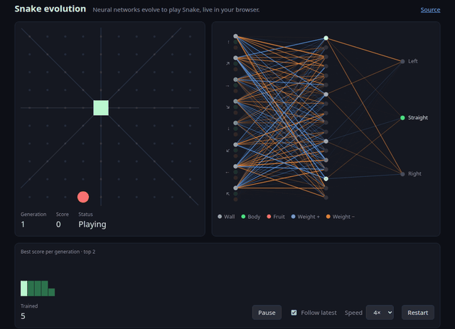

# Snake Brain Transplant Simulator

A Snake game in F# with swappable brains. Give the snake a brain and watch it learn, or watch the best snake of any past generation.

**[Watch it evolve in your browser](https://tzasadil.github.io/Snake-Brain-Transplant-Simulator/)**

## Brains

| Brain | Learns by | What changes | Brain panel |
|---|---|---|---|
| Fruit fly (default) | Evolution | How senses feed a real fly circuit | Circuit at real neuron positions |
| Worm | Evolution | How senses feed the whole worm nervous system | Worm nervous system, side view |
| Neural net | Evolution | All weights | Network, links lit by signal |
| NEAT | Evolution | Weights, plus new links and neurons | Network as it grows |
| Program tree | Evolution | Readable if/else rules | Rules, with the active path lit |
| Q-table | Learning during play | Value of each move in each situation | Best move in every cell |
| Spiking + dopamine | Learning during play | Synapses onto the output neurons | Scrolling spike raster |
| Hamiltonian cycle | Nothing, a fixed algorithm | Nothing | Numbered cycle and next move |

How well each brain learns, with the controls behind each claim: [experiment reports](docs/experiment-reports.md).

## The game

- **Board**: 10x10 grid.
- **Death**: hitting a wall or itself.
- **Starving**: too many moves without fruit also kills, so a brain cannot score by circling forever.
- **Moves**: turn left, go straight, or turn right.

| Senses | Inputs |
|---|---|
| Distance to wall, own body, and fruit along 8 rays | 24 |
| Fruit compass: fruit offset ahead and to the right | 2 |
| Snake length | 1 |

The rays rotate with the snake, so "left" always means the snake's left.

## Evolution

Used by the fruit fly, worm, neural net, NEAT, and program tree.

- **Population**: 100 snakes play one game each, in parallel.
- **Elitism**: the 2 best survive unchanged.
- **Parents**: fitter snakes are more likely to be picked.
- **Children**: mix their parents' genes at random, then mutate a few.

What keeps it learning:

| Rule | Why |
|---|---|
| Gaussian mutation | A fixed step of 0.02 was too weak to tune new inputs |
| 2 games per snake | Cuts the luck of fruit placement |
| Score cut when one turn side exceeds 3:1 | Otherwise populations learn to turn one way only |
| Partial credit for moving toward the fruit, less than one fruit | A population that has not eaten yet still has something to select on |

## Learning during play

Used by the Q-table and spiking + dopamine.

- One snake learns after every move. There is no population.
- After each game, a frozen copy plays one test game. That copy is one bar on the chart, and the board plays these copies.
- So the chart counts games learned instead of generations.

| Event | Reward |
|---|---|
| Eat fruit | +1 |
| Die | -1 |
| Step toward the fruit | +0.1 |
| Step away from the fruit | -0.1 |
| Starve | None: the game ends before the move happens |

## The page

- **Language**: F#, compiled to JavaScript with Fable.
- **Training**: runs in a Web Worker, so playback never stutters.
- **Board**: plays each generation's best snake on a fresh random game.
- **Brain panel**: shows what drives each move.

## Each brain

### Neural net

- A multi-layer perceptron with ReLU: 27 -> 18 -> 3 neurons.
- Evolution tunes every weight.

### NEAT

As in NEAT (Stanley and Miikkulainen 2002).

- Every snake starts with its senses wired straight to the 3 outputs.
- A child can add a link, or split a link into a new neuron.
- Links are matched by their two endpoints instead of NEAT's innovation numbers.
- No speciation.

### Program tree

Genetic programming.

- The brain is a decision tree of tests such as "blocked ahead?" or "fruit to the left?", ending in moves.
- Children swap branches between parents, rewrite single tests or moves, or wrap a branch in a new test.
- At most 4 tests deep, so a tree fits the panel. Tests that cannot change the move are pruned.

### Fruit fly

A real fly brain circuit from the male fruit fly connectome.

| Part | Count |
|---|---|
| Neurons | 251 |
| Synapse bundles | 2,249 |
| Paths from visual neurons to steering | 262 |

- **Extraction**: keeps the strongest routes from visual projection neurons to the steering neurons DNa01 and DNa02. A path's strength is the product of each connection's share of its target's input. After each pick it weakens that path's connections, so later picks find new routes.
- **No shortcuts**: visual neurons wired straight onto steering are left out, so every signal crosses the brain.
- **Fixed**: wiring, signs, and synapse counts.
- **Evolved**: how the snake's senses feed the visual neurons, plus a gain and threshold per neuron, as in [ChessFly](https://huggingface.co/mlabonne/chessfly).
- **Steering**: the snake turns toward the side whose steering neurons fire more.

### Worm

The whole nervous system of the roundworm C. elegans.

| Part | Count |
|---|---|
| Neurons | 299 |
| Chemical synapses | 1,922 |
| Gap junctions | 1,079 |
| Head sensory neurons fed by the senses | 36 |

- **Steering**: the snake turns toward whichever head motor neurons fire more: dorsal (SMDD, RMDD) for left, ventral (SMDV, RMDV) for right, as the worm steers by bending its head.
- **Signs**: from each neuron's transmitter. GABA inhibits, acetylcholine and glutamate excite.
- **Evolved**: the same encoder, gains, and thresholds as the fruit fly.

### Q-table

Q-learning.

- **Situation**: danger to the left, ahead, and right, plus which way the fruit is. 64 situations, 3 moves each.
- **Update**: after every move, that move's value moves toward the reward plus the best value of the next situation.
- **Exploring**: 5% of moves are random.
- **Panel**: the move the table would pick in every cell.

### Spiking + dopamine

| Layer | Neurons |
|---|---|
| Input, driven by the senses at a firing rate | 29 |
| Hidden, leaky integrate-and-fire, fixed random wiring | 40 |
| Output: left, straight, right | 3 |

- **Move**: each move runs 20 time steps. The move is the output that fires most.
- **Trace**: every synapse onto an output keeps a fading trace of recent activity.
- **Dopamine**: the reward, minus its running average. Above it strengthens traced synapses, below it weakens them.
- **Rule**: REINFORCE (Williams 1992) over spike counts, not spike-timing plasticity.
- **Exploring**: while learning, the move is picked at random, weighted by how strongly each output fires.

### Hamiltonian cycle

No learning, a classic algorithm for comparison.

- **Cycle**: a random path through every cell exactly once, back to the start. The cells are numbered along it.
- **Moves**: follow the cycle, but jump to the neighboring cell furthest along it, if the jump passes neither the fruit nor the tail.
- **Safety**: the body always lies in cycle order, so the snake never hits itself.

## What I learned

- A random population either spins in place or drives into a wall. It takes several generations before snakes start chasing fruit.
- Snake gets harder as the snake grows. Unlike Tetris or Flappy Bird, speed does not set the difficulty, so the network needs a different strategy late in the game.
- Fruit on edges and in corners is the main failure. Many evolved snakes learn to patrol the edges.
- Most populations learn to turn in only one direction, and the most one-sided stall around score 26. A fitness penalty for turning one way more than 3:1 fixes that.
- The original mutation (a fixed step of 0.02) was too weak to tune new inputs, so adding inputs made snakes worse. With Gaussian mutation, turn balance, a fruit compass, and length, the mean score at generation 400 rose from 29 to 55 (6 seeds, 100 games each).
- Late-game deaths come from limited vision: the snake only sees along 8 rays, not the whole board.
- Fable 5 checks the bounds of every array read in a library call. In the browser that made training 17x slower than on .NET. Plain JS indexing in the hot loops cut the gap to about 4x.

## Run

Needs the .NET 10 SDK and Node.js with pnpm.

1. Go to `web/`.
2. Run `dotnet tool restore`.
3. Run `pnpm install`.
4. Run `pnpm start` and open the printed URL.

`pnpm build` writes the static site to `web/dist/`. `pnpm test` runs the rule tests.

| Control | Action |
|---|---|
| `Brain` | Fruit fly (default), worm, neural net, NEAT, program tree, Q-table, spiking + dopamine, or Hamiltonian cycle. Switching restarts training. |
| Score chart | Training score of each generation's best snake. Click to watch it play a new game. Arrow keys work too. |
| `Pause` / `Resume` | Stop or continue training. It also pauses every 300 generations. |
| `Follow latest` | Each new champion takes over the game in progress |
| `⏸` / `▶` | Stop or resume the game on the board. Training goes on. |
| `Speed` | Playback speed |
| `Restart` | Train a new random population |
| `New cycle` | Hamiltonian cycle mode only, which does not train: draw a new cycle |

## Code map

### App, in `web/src/`

| File | Role |
|---|---|
| `Game.fs` | Rules and vision, as pure functions |
| `Brain.fs` | Network, crossover, and mutation |
| `Connectome.fs` | Fly and worm circuits: wiring, gap junctions, neuron dynamics, steering readout, and genome |
| `Neat.fs` | NEAT: growing genomes, crossover by link, and compiling a genome for fast play |
| `Program.fs` | Program trees: tests, evaluation, crossover, mutation, and the flat form sent to the page |
| `Hamilton.fs` | Random Hamiltonian cycles and the shortcut rule |
| `QTable.fs` | Q-learning: situations, values, and the update after each move |
| `Spiking.fs` | Spiking neurons, dopamine, and the trace that links them |
| `Mind.fs` | Every kind of brain behind one interface |
| `Evolution.fs` | Selection and the training loop, and the loop for brains that learn during play |
| `Worker.fs` | Trains off the main thread |
| `View.fs` | Draws the board, every brain panel, and the score chart |
| `App.fs` | Playback loop and page controls |

### Tools, in `web/tools/`

| File | Role |
|---|---|
| `extract_fly.py` | Builds `web/data/fly-circuit.json` from the connectome download |
| `extract_worm.py` | Builds `web/data/worm-circuit.json` from OpenWorm data |
| `experiment.fsx` | Short learning runs on .NET, with random-wiring, shuffled-sign, and tunable-weight controls |
| `check-page.mjs` | Headless Chrome check: trains a brain, samples stats, screenshots, reports errors |
| `source-data/` | Raw connectome downloads, gitignored. The extraction scripts list their sources. |

## Legacy desktop app

The original version, built at Charles University, lives in `desktop/`: a Windows WPF app (.NET Framework 4.8) with the neural net only. It is no longer maintained. Open `desktop/snake_Fs.sln` in Visual Studio to run it. [Architecture diagram](https://drive.google.com/file/d/1WRbTG-MDYLCUJCyy3G-27LuXoD9cK_V1/view?usp=sharing)

## Credits

Fruit fly mode uses the Male CNS v1.0 connectome by FlyEM at HHMI Janelia, the University of Cambridge, the MRC Laboratory of Molecular Biology, and Google Research, licensed [CC BY 4.0](https://creativecommons.org/licenses/by/4.0/). Source: [male-cns.janelia.org](https://male-cns.janelia.org). `web/data/fly-circuit.json` is a subset of it.

Worm mode uses the C. elegans wiring of Varshney et al. 2011 (PLoS Comput Biol, CC BY), neurotransmitter identities from Wang et al. 2024 (eLife, CC BY), and soma positions from the WormBase Virtual Worm (public domain), all as redistributed by [OpenWorm](https://openworm.org) (MIT).
